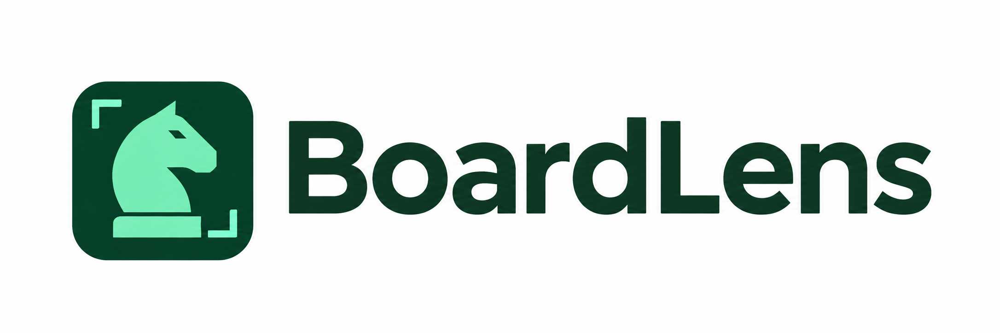
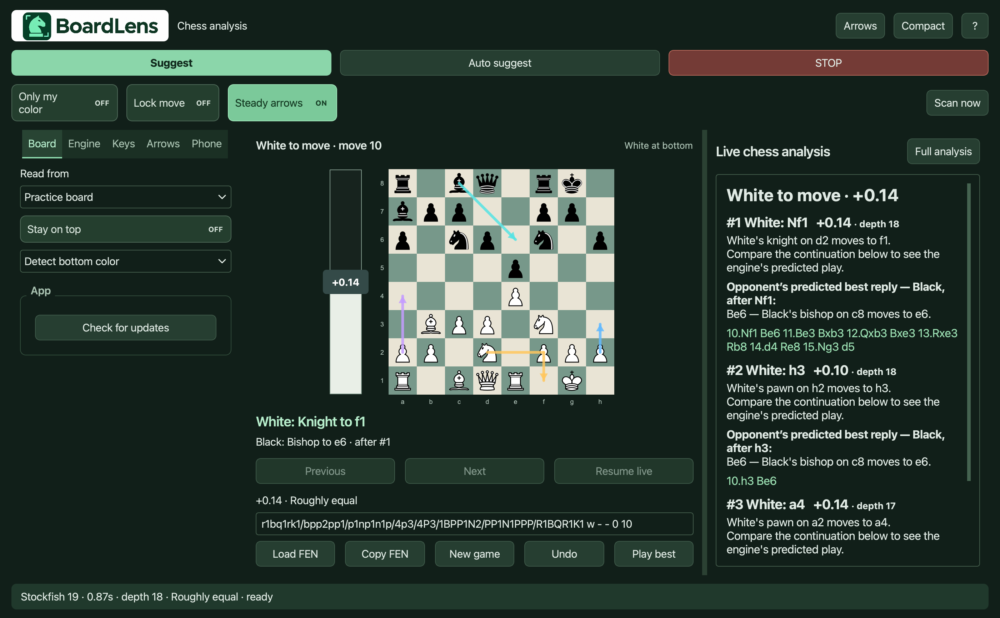
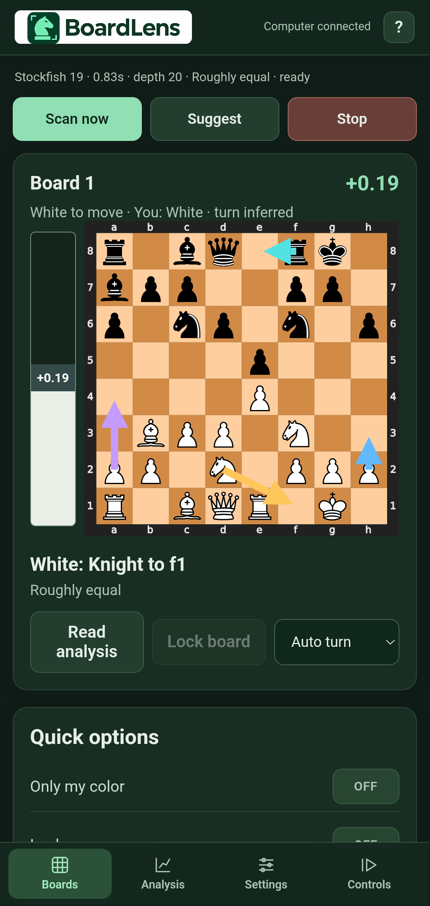
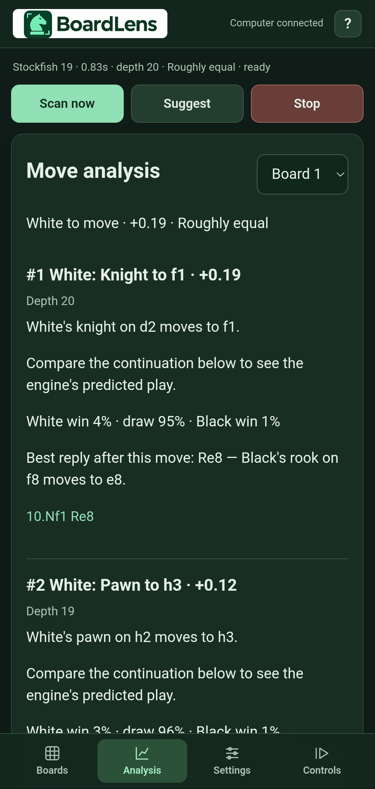
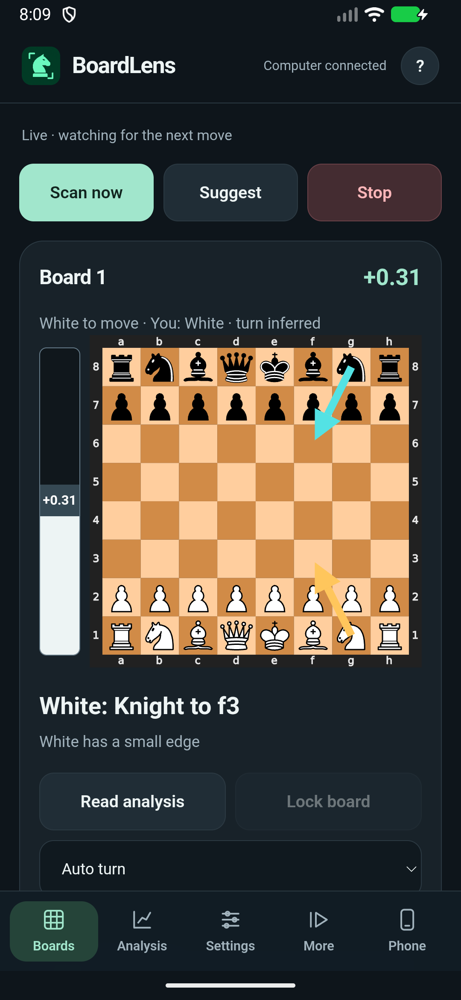
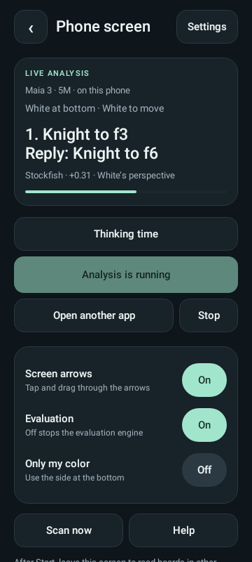
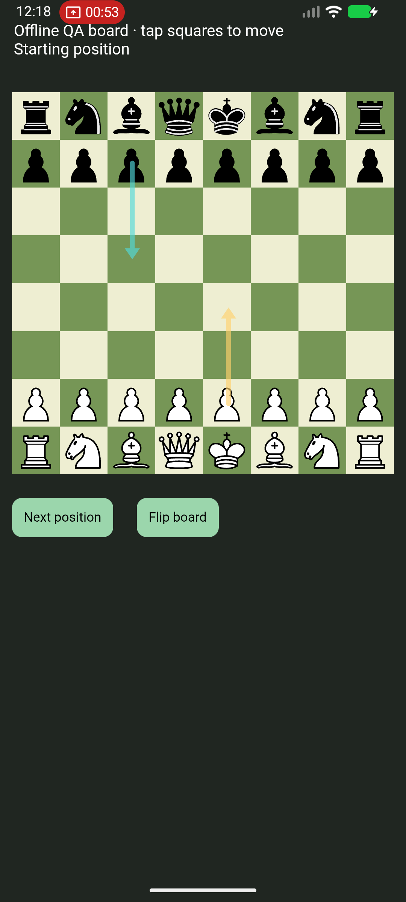

<strong>Your best move. On every screen.</strong> Open-source chess cheating and analysis software for desktop and Android.

<a href="https://github.com/Nick-PY0/BoardLens/releases/latest"><strong>Download BoardLens</strong></a> · <a href="#features">Features</a> · <a href="#phone--tablet">Mobile</a> · <a href="docs/ENGINES.md">Engines</a>

  

BoardLens sees a supported chessboard on your computer, follows its moves and brings engine recommendations, explanations and click-through arrows to your screen. Prefer a clean desktop? Put the interface on your phone while your computer keeps scanning and thinking.

No paid AI subscription is required. Normal recognition and engine analysis run locally after setup. You choose the engine, strength, thinking budget and how much guidance appears.

## See it in action

**Desktop on macOS — the shared Mac/Windows interface**

 

Android companion, captured in an emulator. Real app screens, not design mockups.

### One companion, phone analysis in its menu

 

These new previews render shared production views in an isolated Android component harness. No capture or overlay service runs in that harness.

**Phone analysis** uses the companion’s visual style and appears in its menu. It reads a supported visible board in another Android app, analyzes locally with Stockfish 19, Maia 2, all three Maia 3 sizes, LC0, or the twelve original Tiny bots, and draws passive arrows that let taps reach the board. It has its own Start, Stop, Scan now, engine limits, candidates, orientation and saved settings. Local analysis needs Android 10+ and an arm64 CPU; its verified 99 MB Stockfish data file downloads only when requested.

**Computer companion** keeps the existing Wi-Fi desktop dashboard as a separate section. Phone screen analysis needs no computer or pairing. Maia models are optional, checksum-verified downloads; the twelve original C# Tiny bots are built into the complete APK. Phone settings never change the desktop engine or game. Models → Test installed engines checks actual execution on your device.

The evaluation provider is independent of the move provider: use Stockfish to score the bar while Maia recommends moves. One-move providers can publish their first move, then predict the opponent's reply and your next move. Non-streaming models must finish their first inference before an early result exists. Predictions are possible continuations, not guaranteed play.

Phone capture is explicit, user-started MediaProjection with an ongoing Stop notification. Display-over-other-apps permission enables touch-through arrows. No Accessibility service, boot receiver, screen recording or autoplay is included. Supported flat piece styles are recognized locally; arbitrary 3D themes are not promised. [Phone mode details →](mobile/android/PHONE-SCREEN.md)

> **Android 1.8.2:** [Download the phone-only APK](https://github.com/Nick-PY0/BoardLens/releases/tag/android-v1.8.2). Host/model checks and the full APK build pass; this exact APK still needs physical A35 installation and live capture/overlay testing. Keep normal Android security checks enabled. [Test status →](mobile/TEST-REPORT.txt)

## Download & start

Get [desktop downloads](https://github.com/Nick-PY0/BoardLens/releases/latest) or [Android 1.8.2](https://github.com/Nick-PY0/BoardLens/releases/tag/android-v1.8.2).

| Device | Download | Start |
| --- | --- | --- |
| Mac (Apple Silicon) | `BoardLens-Mac-AppleSilicon.dmg` | Extract, then open **BoardLens.app**. macOS 14+. |
| Mac (Intel) | `BoardLens-Mac-Intel.dmg` | Extract, then open **BoardLens.app**. macOS 14+. |
| Windows 10/11 (64-bit) | `BoardLens-Windows-x64.zip` | Extract the entire folder, then open **BoardLens.exe**. Keep Resources beside it. |
| Android | [BoardLens Android APK](https://github.com/Nick-PY0/BoardLens/releases/download/android-v1.8.2/BoardLens-Companion-Android.apk) | Phone screen → Settings → Models & downloads, then Start. Computer companion is optional. |
| iPhone / iPad | Phone browser, or unsigned iOS source ZIP | Open the desktop companion address. Native source needs Xcode and your signing setup. |

The desktop app includes a private Python runtime, recognition models and Stockfish 19. No Terminal or Python installation is required. The first launch prepares its files in your user profile; later launches reuse them. Settings and optional engines remain in the normal BoardLens app-data folder, including when upgrading from the source version. Optional engines download only when selected. The Mac apps are ad-hoc signed, not notarized; Windows is unsigned. [Desktop installation and build details →](docs/DESKTOP-APPS.md)

`BoardLens-Mac-Windows.zip` is still provided as a source/developer fallback with `.command` and `.bat` launchers.
1. Open a complete supported board on your computer.
2. **Board → Read from → Computer screen**; choose a display or all displays.
3. Press **Scan now**, then enable **Auto suggest** to follow moves.
4. Set your engine and limits in **Engine**. Use **Arrows** to control what appears.

## Features

| Feature | What you get |
| --- | --- |
| Automatic screen reading | Finds supported flat 2D boards, without manually selecting an area. Monitor selection and all-display discovery. |
| Fresh scan | Scan now cancels stale work and reads the visible position again. |
| Three-board analysis | Up to three independent tracked positions, engine sessions and recommendations. Cards appear or disappear as boards change. |
| Target lock | Keep one board selected while switching apps; missing or covered pixel targets pause. |
| Orientation detection | Detect the bottom color and optionally show suggestions only for your side. Turn overrides handle uncertain positions. |
| Candidate moves | Show 1–10 recommendations when the selected engine supports them. Rank filters, colors and candidate count control the arrows too. |
| Opponent continuations | See the opponent's predicted reply after a candidate, separately labelled from current-turn recommendations. |
| Plain-language moves | Read “Bishop to f4” alongside SAN, continuation lines and move explanations. |
| Evaluation | Signed White-perspective score, advantage text, mate scores and a board-height evaluation bar. It is not a calibrated winning percentage. |
| Passive screen overlay | Candidate and reply arrows let mouse clicks through. Toggle overlays independently of scanning. |
| Steady arrows | Keep calculating while smoothing changing recommendations. Lock move can hold one suggestion until the board changes or you rescan. |
| Threat highlights | Estimated material-risk rings, optional attacked-square dots and legal mate-in-one targets. |
| Engine controls | Manual engine selection, threads, hash memory, supported strength controls, time/depth/adaptive budgets and early results. |
| Playing styles | Balanced, aggressive, defensive and human-like candidate selection where supported. Maia uses trained human-move models. |
| Engine comparison | Compare 2–3 selected providers on the same position. |
| Optional engine library | Choose individual engines, lightweight downloads or larger neural models. No silent switching or model downloads. |
| Named presets | Quick and Deep presets plus your saved engine/arrow configurations. |
| Position history | Previous/Next pauses live tracking; Resume live returns to the current board. |
| Local Practice board | Load/copy FEN, move pieces, undo and manually play one engine move. |
| Screenshot input | Analyze a supported complete board from an image, including phone uploads. |
| Keyboard shortcuts | Custom shortcuts for suggestions, scanning, arrows, history and Stop. Global shortcuts depend on OS permissions. |
| Clean layout | Compact/expanded desktop views, large board and evaluation, full analysis view and adjustable text size. |
| Persistent settings | Preferences save automatically; phone edits sync back to desktop. Copy actions show feedback. |
| Searchable Help | Sectioned offline guides, full questions, related phrases and common typo matching. |
| GitHub updates | Desktop **Board → App → Check for updates**. Android has an update button on its connection screen and in **Controls**. |

### Themes and 3D

- **2D screen scanning** works independently of the browser connection, for supported artwork.
- **Optional browser reader:** Chess.com/Lichess board data is read independently of its piece artwork. Supported Chess.com 3D boards use projected arrow coordinates. Pair the included Chrome/Edge extension under **Optional connections**; keep the chess tab visible. Site changes can require adapter updates.
- **Local 3D chess:** an independent macOS Accessibility reader supports the built-in Chess.app's 64 accessible squares and projected bounds. It does not cover every 3D chess application.
- Browser and Local 3D connections have separate switches and connection/repair status. Standard screen scanning does not require either reader.

### Phone & tablet

Your computer remains the screen reader and engine host. Its window can stay minimized while the phone provides **Boards, Analysis, Settings and Controls**.

- View up to three boards, candidate arrows, evaluation, explanations and engine comparison.
- Change engine/arrow settings and named presets; edits sync and save on the computer.
- Scan, suggest, Stop, pause/resume, browse history and control local Practice positions.
- Set keyboard shortcuts, upload a screenshot, copy a FEN/configuration and search Help.
- Native Android respects system bars, camera cutouts and the keyboard. Automatic update checks open GitHub; Android handles installation.
- Any reachable phone/tablet browser can use the same local companion page. The native iOS wrapper is source-only and unsigned.

**Connect:** desktop **Phone → Enable phone companion**, then enter the displayed computer address and six-digit code on the phone. Use the same trusted local network. Keep the computer awake. Restarting the companion requires its new pairing code.

## Engines

**Stockfish, Maia-3 (5M / 23M / 79M), Maia-2 Rapid, Flounder, Custom UCI**, and twelve optional Tiny Chess Bots. [See engine names, reference ratings and supported controls →](docs/ENGINES.md)

Different engines expose different capabilities. Maia predicts human moves; Tiny bots provide one chosen move without a numerical evaluation or alternative ranked lines. The UI disables unsupported controls.

## Updates

Desktop automatically checks and downloads checksum-verified stable updates, then applies them at the next launch with rollback and preserved user data. Switch this off under **Board → App**. Android automatically checks releases and opens GitHub for installation through Android; it has no custom APK installer or install-packages permission. [Update and release details →](docs/UPDATES.md)

The first public release is **v1.0.0**. The new desktop is **2.16.0**, with Android **1.8.2** available separately. See the latest release for the exact downloadable build and installation-test status.

## What is verified

The validation report records **199 automated desktop tests**, plus packaged app tests on Apple Silicon macOS, Intel macOS and a Windows CI runner. Each packaged test launches the actual GUI app with its private runtime, recognizes a fixture and asks bundled Stockfish for a legal move. Windows verifies no console window. A Windows physical desktop and physical Android/iOS devices have not been tested. The fixed screen-polling target is 75 ms; recognition, engine thinking, display capture and network time still affect end-to-end latency. Current native OS pixel capture has not been reverified; fixture tests are not proof of capture permission/behavior.

Pixel reads need a clear board and cannot always recover turn, castling or en-passant history. Use exact FEN or a supported direct reader when that metadata matters. Threat checks and engine explanations are estimates. There is no autoplay, stealth/anti-detection guarantee, Study, coaching, puzzles or game-journal feature in this release. Use assistance where your game mode permits it.

## Build & contribute

See [CONTRIBUTING.md](CONTRIBUTING.md). The source is organized into `desktop/` and `mobile/`; branding and real UI screenshots are in `docs/`.

GPL-3.0-or-later. Bundled recognition models, artwork and other components retain their notices in [desktop/THIRD-PARTY.txt](desktop/THIRD-PARTY.txt). BoardLens is not affiliated with Chess.com, Lichess or the engine authors.

Phone screen arrows — development test

Emulator development test. The APK remains withheld after Play Protect blocked installation.

### Clearer controls and permissions

- **Show moves while thinking** displays the first useful result before the engine finishes.
- **Prediction length** counts individual moves (plies). A three-ply line is your move, a possible opponent reply, then your response.
- **Reply time budget** limits extra prediction passes. Maia 2 and all Maia 3 model sizes use one pass per position; this is not a pretend search-depth setting. A running pass can finish after the budget. Tiny bots retain their coded search and accept a clock budget.
- **Manual** means individual settings; named presets remember a chosen engine and its controls.
- The Mac permission page pauses screen reading when required access is missing. Source updates preserve the installed native host and saved choices.
- The new context classifier extends tested piece artwork and uses projected board coordinates for arrows. Coverage is experimental; see [actual recognition results](docs/recognition/README.md). Hidden or indistinguishable pieces cannot be reconstructed from a screenshot.

### Mac installation

Download the Apple silicon or Intel DMG, open it, and drag **BoardLens → Applications**. Eject the installer and open the installed app. The installer uses a fixed, Retina-ready layout and a rounded app icon. Settings stay in your user profile when you replace the app.

Accessibility is checked quietly on launch. Only the local 3D reader needs it; ordinary 2D screen reading uses Screen Recording, and global shortcuts use the native hotkey system. Restoring saved settings never opens an Accessibility request. Use **Board → App → Permissions** for an explicit permission action.

### Mac permission recovery and quicker startup

The Mac build now starts from its bundled runtime instead of unpacking Python
on first launch. Isolated local checks showed the window in 2.7 seconds on a
fresh bootstrap and 1.6 seconds on repeat; timing varies by computer. The engine
still uses your selected thinking limit.

The permission page can be dismissed with **Use app without scanning**. Live
scanning stays paused while required macOS access is denied. Restoring saved
settings does not open OS prompts. Developer ID builds use a stable signing
identity; builds marked ad hoc can require renewed access after a native update.
If an older entry is switched on but access remains denied, remove the old
BoardLens entry, add Applications → BoardLens.app, enable it and reopen the app.
Source updates preserve the installed native host. See [installer details](desktop/packaging/INSTALLER.md).
